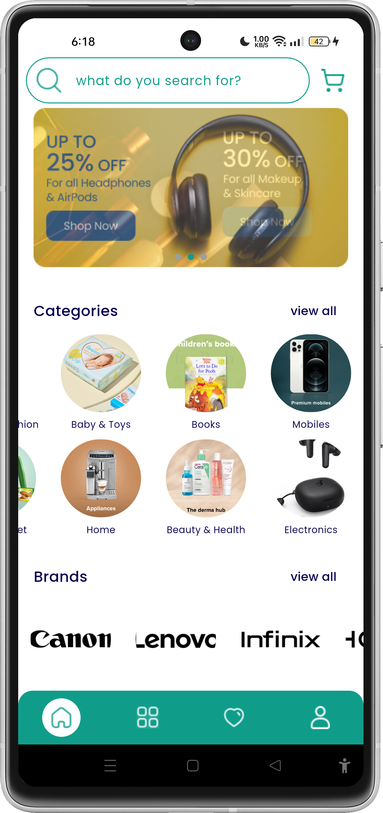

# Ecommerce App

A production-ready mobile e-commerce client built with Flutter, demonstrating Clean Architecture, BLoC pattern, and REST API integration.


---

## Table of Contents

- [Features](#features)
- [Screenshots](#screenshots)
- [Tech Stack](#tech-stack)
- [Architecture](#architecture)
- [Getting Started](#getting-started)
- [Future Improvements](#future-improvements)
- [Contributing](#contributing)
- [License](#license)
- [Author](#author)

---

## Features

- **Authentication & Session Management**
  - User registration and login with form validation.
  - Persistent auth tokens saved in local storage (`SharedPreferences`).
  - Auto-login check on app splash launch.
  - Token injection via Dio interceptors for authenticated API endpoints.
  - Secure account sign-out and session clearance.

- **Home Dashboard & Exploration**
  - Interactive promotional banner carousel with page indicators.
  - Dynamic category list horizontal scroll.
  - Brand showcase items.
  - Best-selling and featured product showcase.

- **Categories & Subcategories**
  - Category selection view with subcategory side-navigation.
  - Direct filtering of products by category and subcategory.

- **Product Listing & Filtering**
  - Responsive grid layout displaying product cards with image, price, and rating.
  - Real-time product search.
  - Quick action to toggle items in wishlist.
  - Direct add-to-cart functionality from product list cards.

- **Product Details**
  - Detailed product screen with image gallery.
  - Expandable product description view.
  - Quantity selection counter with real-time price updates.
  - Color and variant selection support.

- **Shopping Cart**
  - Cart overview listing items with updated counts and price summaries.
  - Quantity controls (increment/decrement) per item.
  - Swipe-to-delete item actions via slidable list items.
  - Order subtotal calculation.

- **Wishlist**
  - Personal favorite items list.
  - Toggle items in/out of wishlist.
  - Quick add-to-cart option from wishlist items.

- **User Profile & Account Settings**
  - Profile details display.
  - Delivery address management (viewing, adding, removing addresses).
  - Password change options.

---

## Screenshots

<div align="center">
  <table>
    <tr>
      <td align="center">
        <br/>
        <sub>Splash Screen</sub>
      </td>
      <td align="center">
        <br/>
        <sub>Home Screen</sub>
      </td>
      <td align="center">
        <br/>
        <sub>Categories & Subcategories</sub>
      </td>
      <td align="center">
        <br/>
        <sub>Product Listing</sub>
      </td>
    </tr>
    <tr>
      <td align="center">
        <br/>
        <sub>Wishlist Screen</sub>
      </td>
      <td align="center">
        <br/>
        <sub>Shopping Cart</sub>
      </td>
      <td align="center">
        <br/>
        <sub>Account & Profile</sub>
      </td>
      <td align="center"></td>
    </tr>
  </table>
</div>

---

## Tech Stack

| Category | Technology / Package | Description |
|---|---|---|
| **Framework** | Flutter (`>=3.3.0`) | Cross-platform UI toolkit |
| **Language** | Dart (`^3.8.0`) | Primary programming language |
| **State Management** | `flutter_bloc` (`^9.1.1`), `bloc` (`^9.2.1`) | Cubit-based state management |
| **Networking** | `dio` (`^5.11.0`), `retrofit` (`^4.10.0`), `pretty_dio_logger` | REST API requests, interceptors, and network logging |
| **Dependency Injection** | `get_it` (`^9.3.0`), `injectable` (`^3.0.0`) | Service locator and compile-time dependency injection |
| **Navigation** | `go_router` (`^17.5.0`) | Declarative routing and navigation |
| **Local Storage** | `shared_preferences` (`^2.5.6`) | Persistent key-value storage for tokens and user sessions |
| **UI & Layout** | `flutter_screenutil`, `cached_network_image`, `carousel_slider_plus`, `smooth_page_indicator`, `flutter_slidable`, `flutter_svg`, `google_fonts`, `readmore_flutter`, `auto_size_text` | Screen responsiveness, caching, image sliders, custom fonts, expandable text, slidable lists |
| **Code Generation** | `build_runner`, `retrofit_generator`, `json_serializable`, `injectable_generator` | Code generation for JSON serialization, API clients, and DI |

---

## Architecture

This project follows **Clean Architecture** to ensure maintainability, testability, and separation of concerns.

```text
               ┌────────────────────────┐
               │   Presentation Layer   │
               │  (Widgets, Cubits, UI) │
               └───────────┬────────────┘
                           │
                           ▼
               ┌────────────────────────┐
               │      Domain Layer      │
               │ (Entities, Use Cases)  │
               └───────────▲────────────┘
                           │
                           ▼
               ┌────────────────────────┐
               │       Data Layer       │
               │ (Repositories, DTOs)   │
               └────────────────────────┘
```

- **Presentation Layer**: Handles UI layouts, user events, and view states using Cubit view models and GoRouter navigation.
- **Domain Layer**: Contains business entities, repository contracts, and use cases. Completely framework-agnostic.
- **Data Layer**: Implements domain repository interfaces using remote REST data sources (Retrofit/Dio) and local caching (SharedPreferences), mapping DTO responses to domain entities.

### Folder Structure

```text
lib/
├── api/                      # REST endpoints, DTO models, Mappers, Retrofit services & Dio interceptors
│   ├── data_source/          # Remote and Local data source implementations
│   ├── dio/                  # Dio client instance and DI setup
│   ├── mapper/               # DTO to Entity data mappers
│   ├── model/                # Request & Response DTOs
│   └── retrofit/             # Retrofit API interface definitions
├── core/                     # Shared utilities, theme, route configuration, and reusable widgets
│   ├── cache/                # SharedPreferences helper wrapper
│   ├── di/                   # GetIt & Injectable dependency injection configuration
│   ├── exceptions/           # Custom exception definitions
│   ├── routes_manager/       # GoRouter definitions and route paths
│   ├── utils/                # Colors, text styles, and assets definitions
│   └── widget/               # Reusable UI components (AppBars, buttons, text fields)
├── data/                     # Repository interfaces and concrete repository implementations
│   ├── data_source/          # Remote & Local data source contracts
│   └── repository/           # Data layer repository implementations
├── domain/                   # Pure business logic layer
│   ├── entities/             # Core domain models
│   ├── repository/           # Repository interfaces
│   └── usecases/             # Application use cases
├── features/                 # Modular feature presentation components and Cubits
│   ├── auth/                 # Sign In and Registration screens & logic
│   ├── cart/                 # Shopping Cart screen and cart state management
│   ├── main_layout/          # Bottom navigation tabs (Home, Categories, Wishlist, Profile)
│   ├── product_details/      # Detailed product screen and widgets
│   ├── products_screen/      # Product listing screen
│   └── splash/               # Splash screen and authentication state check
└── main.dart                 # Application entry point
```

---

## Getting Started

### Prerequisites

- [Flutter SDK](https://docs.flutter.dev/get-started/install) (`>=3.3.0`)
- [Dart SDK](https://dart.dev/get-started) (`^3.8.0`)
- IDE: Android Studio, VS Code, or IntelliJ IDEA with Flutter plugins installed.

### Installation

1. **Clone the repository:**
   ```bash
   git clone https://github.com/[Your-Username]/ecommerce-app-final-design.git
   cd ecommerce-app-final-design
   ```

2. **Install dependencies:**
   ```bash
   flutter pub get
   ```

3. **Run code generation:**
   ```bash
   dart run build_runner build --delete-conflicting-outputs
   ```

4. **API Configuration:**
   - Default backend Base URL: `https://ecommerce.routemisr.com/api/v1/` configured in `lib/api/model/api_constants/api_endpoints.dart`.

5. **Run the application:**
   ```bash
   flutter run
   ```

---

## Future Improvements

- [ ] Payment gateway integration after checkout in shopping cart *(in progress)*.
- [ ] Order history and tracking dashboard.
- [ ] Unit, widget, and integration testing suite.
- [ ] Offline caching and offline mode support.
- [ ] Multi-language support and internationalization (i18n).
- [ ] Dark theme mode toggle.

---

## Contributing

Contributions are welcome! Please follow these steps to contribute:

1. Fork the project.
2. Create your feature branch (`git checkout -b feature/AmazingFeature`).
3. Commit your changes (`git commit -m 'Add some AmazingFeature'`).
4. Push to the branch (`git push origin feature/AmazingFeature`).
5. Open a Pull Request.

---

## License

This project is licensed under the MIT License - see the `LICENSE` file for details.

---

## Author

**[Your Name]**

- GitHub: [@yourusername](https://github.com/fatmanagaa)
- LinkedIn: [Your Name](https://www.linkedin.com/in/fatma-gomaa-52b776280/)
- Email: fatmanaga43@gmail.com
