# Cartify

A mobile e-commerce client built with Flutter, following Clean Architecture, BLoC/Cubit, and REST API integration.


---

## Demo

Demo video: [Watch here](https://drive.google.com/file/d/1da0R7rsZynWMlrIPDsQEWd4Occvtp6qp/view?usp=sharing)

APK download: coming soon

---

## Table of Contents

- [Demo](#demo)
- [Features](#features)
- [Screenshots](#screenshots)
- [Tech Stack](#tech-stack)
- [Architecture](#architecture)
- [Key Decisions](#key-decisions)
- [Getting Started](#getting-started)
- [Future Improvements](#future-improvements)
- [License](#license)
- [Author](#author)

---

## Features

- **Authentication & Session Management**: User registration, login, password recovery, session sign-out, and auto-login splash launch check.
- **Home Dashboard & Exploration**: Interactive promotional banner carousel, category listings, brand showcase, and featured products.
- **Categories & Subcategories Navigation**: Category browsing with subcategory filtering and side navigation.
- **Product Listing & Search**: Responsive grid layout with real-time product search, ratings, pricing, and quick wishlist/cart actions.
- **Product Details View**: Comprehensive product detail view with image gallery, expandable description, variant options, and quantity selection.
- **Shopping Cart**: Shopping cart management with price calculations, quantity controls, and slidable item deletion.
- **Wishlist Management**: Personal favorite items list with toggle support and quick add-to-cart functionality.
- **User Profile & Account Settings**: User details display, delivery address management (add, view, remove), and password change options.

---

## Screenshots

<div align="center">
  <table>
    <tr>
      <td align="center">
        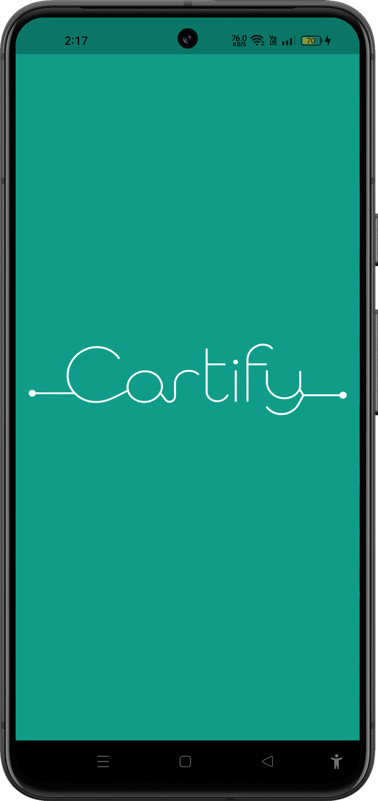<br/>
        <sub>Splash Screen</sub>
      </td>
      <td align="center">
        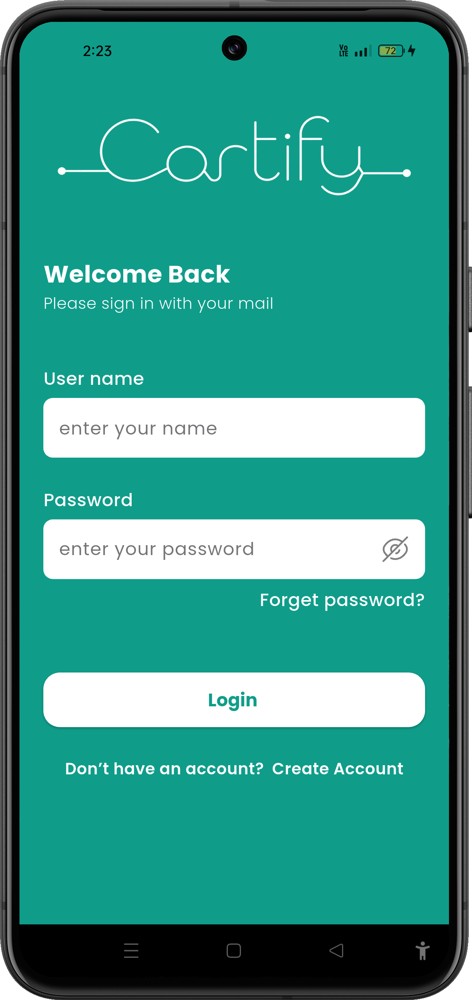<br/>
        <sub>Login Screen</sub>
      </td>
      <td align="center">
        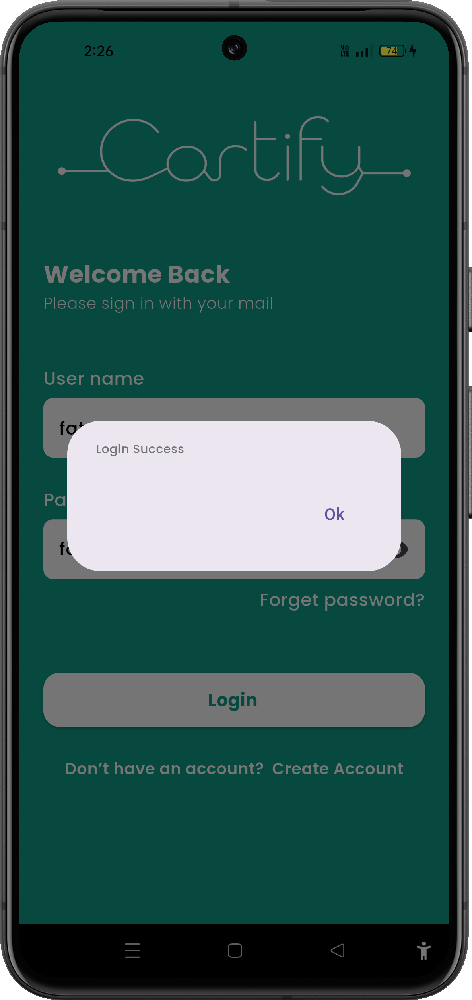<br/>
        <sub>Login (Form)</sub>
      </td>
      <td align="center">
        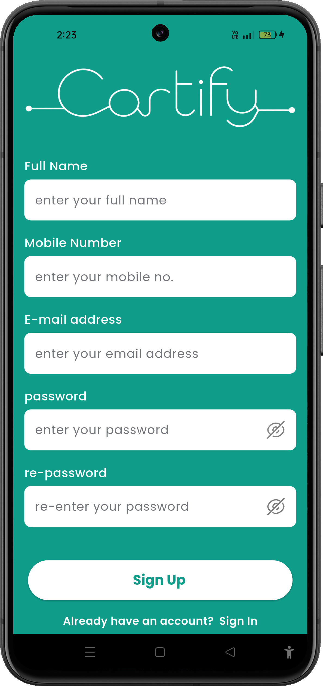<br/>
        <sub>Register Screen</sub>
      </td>
    </tr>
    <tr>
      <td align="center">
        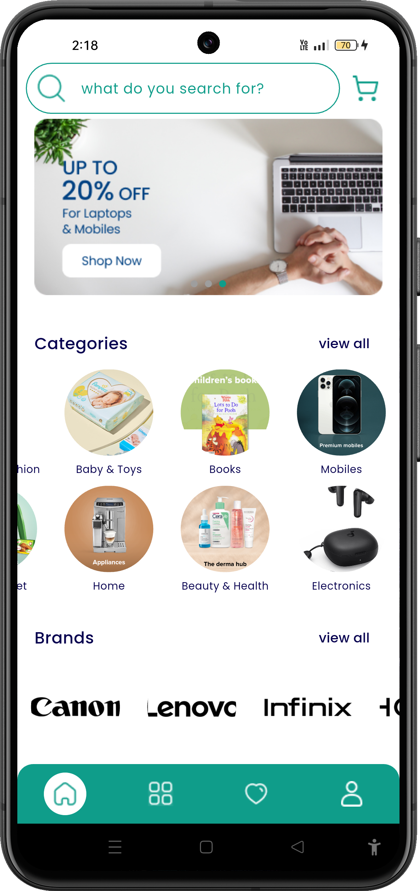<br/>
        <sub>Home Screen</sub>
      </td>
      <td align="center">
        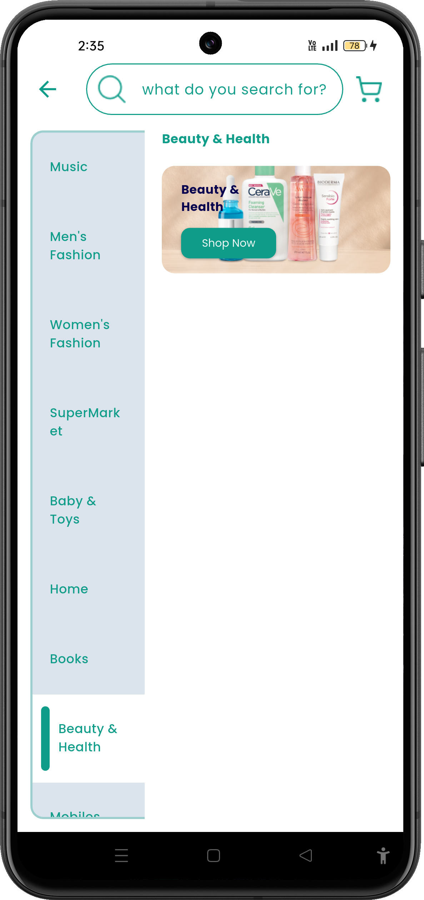<br/>
        <sub>Subcategories Screen</sub>
      </td>
      <td align="center">
        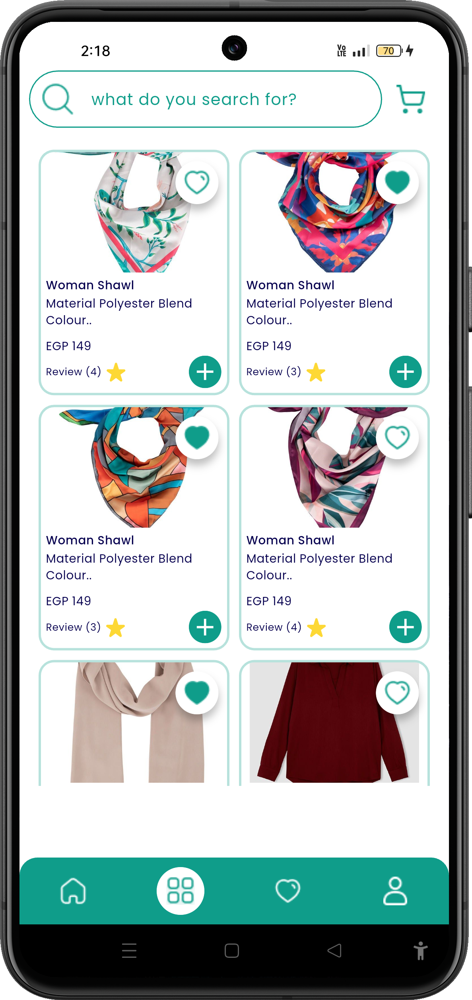<br/>
        <sub>Product Listing</sub>
      </td>
      <td align="center">
        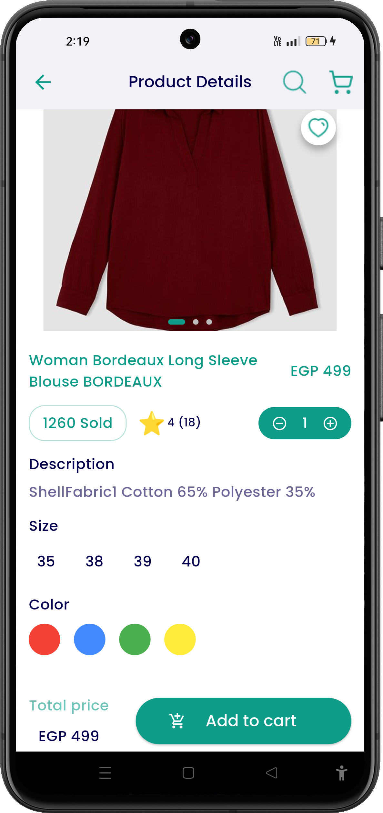<br/>
        <sub>Product Details</sub>
      </td>
    </tr>
    <tr>
      <td align="center">
        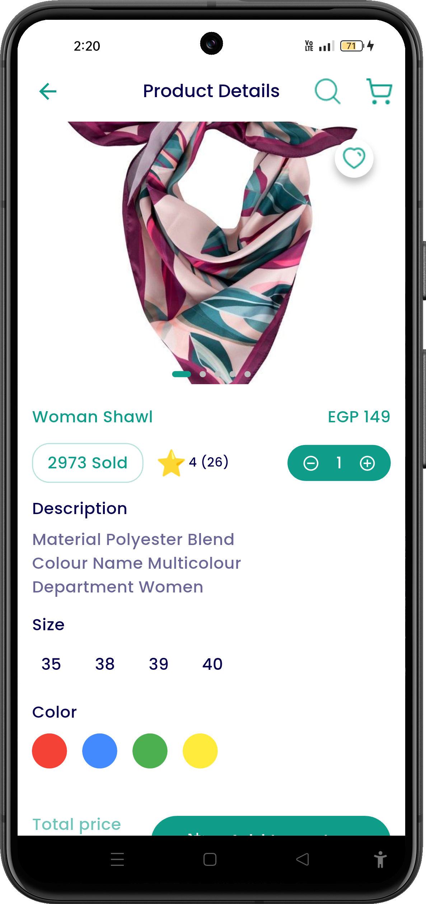<br/>
        <sub>Product Details View</sub>
      </td>
      <td align="center">
        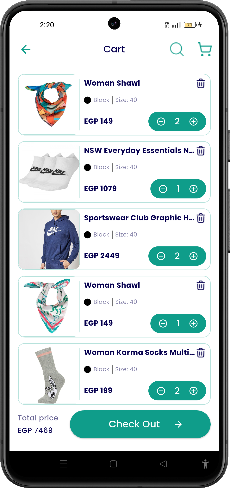<br/>
        <sub>Shopping Cart</sub>
      </td>
      <td align="center">
        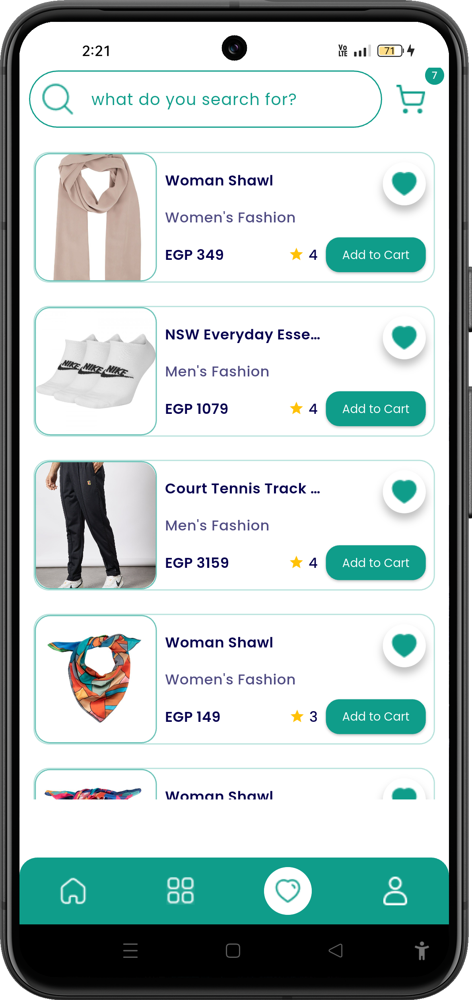<br/>
        <sub>Wishlist Screen</sub>
      </td>
      <td align="center">
        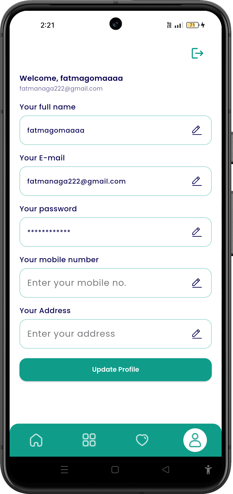<br/>
        <sub>Profile Screen</sub>
      </td>
    </tr>
  </table>
</div>

---

## Tech Stack

| Category | Technology / Package | Description |
|---|---|---|
| **Framework** | Flutter (`>=3.3.0`) | Cross-platform UI toolkit |
| **Language** | Dart (`^3.8.0`) | Primary programming language |
| **State Management** | `flutter_bloc` (`^9.1.1`), `bloc` (`^9.2.1`) | Cubit-based state management |
| **Networking** | `dio` (`^5.11.0`), `retrofit` (`^4.10.0`), `pretty_dio_logger` (`^1.4.0`) | REST API requests, interceptors, and network logging |
| **Dependency Injection** | `get_it` (`^9.3.0`), `injectable` (`^3.0.0`) | Service locator and compile-time dependency injection |
| **Navigation** | `go_router` (`^17.5.0`) | Declarative routing and navigation |
| **Local Storage** | `shared_preferences` (`^2.5.6`) | Persistent key-value storage for tokens and user sessions |
| **UI & Layout** | `flutter_screenutil`, `cached_network_image`, `carousel_slider_plus`, `smooth_page_indicator`, `flutter_slidable`, `flutter_svg`, `google_fonts` (`^8.2.1`), `readmore_flutter` (`^1.1.3`), `auto_size_text` | Screen responsiveness, caching, image sliders, custom fonts, expandable text, slidable lists |
| **Code Generation** | `build_runner` (`^2.15.1`), `retrofit_generator` (`^10.2.9`), `json_serializable` (`^6.14.1`), `injectable_generator` (`^3.0.2`) | Code generation for JSON serialization, API clients, and DI |

---

## Architecture

This project follows **Clean Architecture** to ensure maintainability, testability, and separation of concerns.

```text
               ┌────────────────────────┐
               │   Presentation Layer   │
               │  (Widgets, Cubits, UI) │
               └───────────┬────────────┘
                           │
                           ▼
               ┌────────────────────────┐
               │      Domain Layer      │
               │ (Entities, Use Cases)  │
               └───────────▲────────────┘
                           │
                           ▼
               ┌────────────────────────┐
               │       Data Layer       │
               │ (Repositories, DTOs)   │
               └───────────┴────────────┘
```

- **Presentation Layer**: Resides in `lib/features/`, handling UI layouts, user events, and view states using Cubit view models and GoRouter navigation.
- **Domain Layer**: Resides in `lib/domain/`, containing business entities, repository contracts, and use cases. Completely framework-agnostic.
- **Data Layer**: Split between `lib/api/` (DTOs, Retrofit REST API interface, Dio client, data mappers, and remote/local data source implementations) and `lib/data/` (data source interface contracts and repository implementations).

### Folder Structure

```text
lib/
├── api/                      # Remote & local data source implementations, DTOs, Retrofit client, Dio config & mappers
│   ├── data_source/          # Data source implementations (local & remote)
│   ├── dio/                  # Dio client instance and DI setup
│   ├── mapper/               # DTO to Entity data mappers
│   ├── model/                # Request & Response DTOs, API endpoints
│   └── retrofit/             # Retrofit API interface definitions
├── core/                     # Shared utilities, theme, route configuration, and reusable widgets
│   ├── api_states/           # API state management wrappers
│   ├── cache/                # SharedPreferences helper wrapper
│   ├── di/                   # GetIt & Injectable dependency injection configuration
│   ├── exceptions/           # Custom exception definitions
│   ├── routes_manager/       # GoRouter definitions and route paths
│   ├── utils/                # Colors, text styles, and assets definitions
│   └── widget/               # Reusable UI components
├── data/                     # Repository implementations and data source contracts
│   ├── data_source/          # Data source interface contracts (local & remote)
│   └── repository/           # Data layer repository implementations
├── domain/                   # Pure business logic layer
│   ├── entities/             # Core domain models
│   ├── repository/           # Abstract repository interfaces
│   └── usecases/             # Application use cases
├── features/                 # Presentation layer (UI screens, widgets, and Cubits)
│   ├── auth/                 # Sign In and Registration screens & logic
│   ├── cart/                 # Shopping Cart screen and cart state management
│   ├── main_layout/          # Bottom navigation tabs (Home, Categories, Wishlist, Profile)
│   ├── product_details/      # Detailed product screen and logic
│   ├── products_screen/      # Product listing screen and filtering logic
│   └── splash/               # Splash screen and authentication state check
└── main.dart                 # Application entry point
```

---

## Key Decisions

- **Cubit (over full BLoC)**: Selected for state management to eliminate event mapping boilerplate; methods directly trigger state changes via functions, keeping UI state predictable and straightforward.
- **GoRouter**: Used for declarative routing and deep linking, providing clean navigation and parameter passing across features.
- **Retrofit with Dio**: Combines Retrofit's compile-time REST client generation with Dio's flexible HTTP handling, including interceptors for logging and auth token handling.
- **GetIt with Injectable**: Provides compile-time dependency injection to decouple presentation, domain, and data layers cleanly without manual service registration boilerplate.

---

## Getting Started

### Prerequisites

- [Flutter SDK](https://docs.flutter.dev/get-started/install) (`>=3.3.0`)
- [Dart SDK](https://dart.dev/get-started) (`^3.8.0`)
- IDE: Android Studio, VS Code, or IntelliJ IDEA with Flutter plugins installed.

### API Configuration

This application consumes a public third-party REST API and the backend was not developed as part of this project.
- Base URL: `https://ecommerce.routemisr.com/api/v1/` (configured in `lib/api/model/api_constants/api_endpoints.dart`).

### Installation

1. **Clone the repository:**
   ```bash
   git clone https://github.com/fatmanagaa/ecommerce-app-final-design.git
   cd ecommerce-app-final-design
   ```

2. **Install dependencies:**
   ```bash
   flutter pub get
   ```

3. **Run code generation:**
   ```bash
   dart run build_runner build --delete-conflicting-outputs
   ```

4. **Run the application:**
   ```bash
   flutter run
   ```

---

## Future Improvements

- [ ] Payment gateway integration after checkout in shopping cart *(in progress)*.
- [ ] Order history and tracking dashboard.
- [ ] Unit, widget, and integration testing suite.
- [ ] Offline caching and offline mode support.
- [ ] Multi-language support and internationalization (i18n).
- [ ] Dark theme mode toggle.
- [ ] Migrate token storage from SharedPreferences to flutter_secure_storage.

---

## License

This project is licensed under the MIT License - see the `LICENSE` file for details.

---

## Author

**Fatma Gomaa**

- GitHub: [@fatmanagaa](https://github.com/fatmanagaa)
- LinkedIn: [Fatma Gomaa](https://www.linkedin.com/in/fatma-gomaa-52b776280/)
- Email: fatmanaga43@gmail.com
